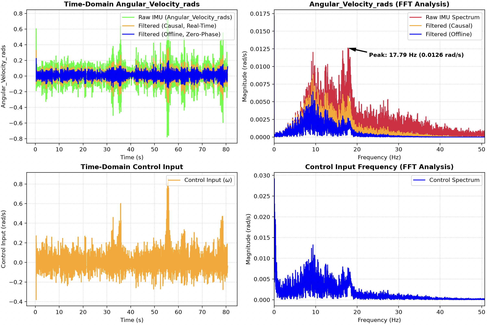
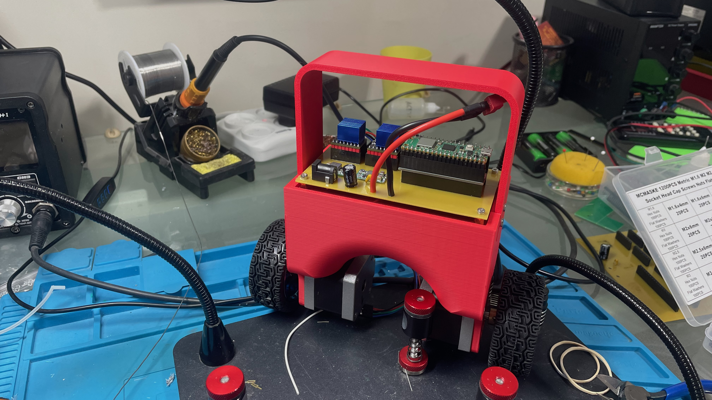
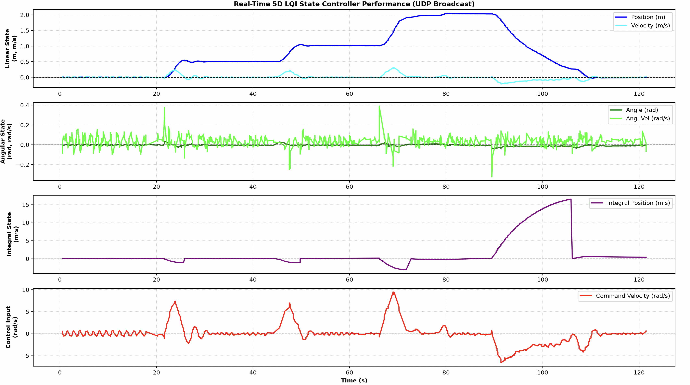
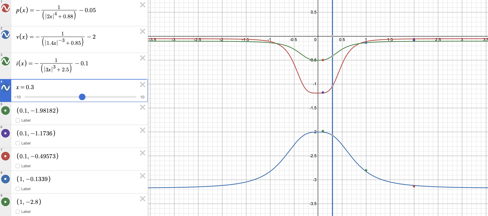

# 2 Wheels self balancing robot

A self-balancing robot modeled using a linearized state-space representation and implemented on a Raspberry Pi Pico with an IMU sensor and NEMA 17 stepper motors. The project includes the physical system modeling and core real-time control algorithm, along with Python-based tools for experimental data analysis, signal processing, and real-time visualization of system states and control signals.

---
## Robot in action

https://github.com/user-attachments/assets/70e26cd5-e973-4f93-8034-186bfde12b96

---
## 📌 Features

* **5D LQI State Control:** Regulates linear position ($x$), linear velocity ($\dot{x}$), pitch angle ($\theta$), pitch angular velocity ($\dot{\theta}$), and integrated position error ($x_{\text{int}}$) to guarantee zero steady-state position drift.
* **2D LQR State Control:** Reduced-order state controller regulating only pitch angle ($\theta$) and pitch angular velocity ($\dot{\theta}$).


**Note:** Switch between control algorithms by toggling the respective class instances/comments in `main.cpp`.

* **Control Analysis:** (`control_analysis.py`) performs the mathematical pre-calculation of controller gains and provides stability and state-convergence analysis.
* **Real-Time plot:** (`RTplot.py`) Displays states of the system in real time and records to signal_records
* **Vibration analysis:** (`dsp.py`) provides a signal spectral analysis (FFT) of chosen state. I added a plot of filtered signal by 1st-order IIR with cutoff ($f_c = 10\text{ Hz}$), that also implemented on the IMU gyro output on (`hardware.cpp`)

---

## 🧮 Control Architecture & Physics

The robot is modeled as a non-minimum phase coupled inverted pendulum system operating at a $200\text{ Hz}$ control loop ($T_s = 5\text{ ms}$).

### 5D State Vector
$$\mathbf{x} = \begin{bmatrix} x & \dot{x} & \theta & \dot{\theta} & x_{\text{int}} \end{bmatrix}^T$$

Where $x_{\text{int}} = \int (x - x_{\text{ref}}) \, dt$.

### State-Space Representation

The system uses commanded motor angular acceleration as the control input ($u = \dot{\omega}_{\text{wheel}}$):

$$
\dot{\mathbf{x}} = \mathbf{A}\mathbf{x} + \mathbf{B}u
$$

$$
u = -\mathbf{K}\mathbf{x} \quad, \mathbf{K} = \mathbf{R}^{-1} \mathbf{B}^T \mathbf{P}
$$

$$
\mathbf{A} = \begin{bmatrix} 
1 & T_\text{s} & 0 & 0 & 0 \\ 
0 & 1 & 0 & 0 & 0 \\ 
0 & 0 & 1 & T_\text{s} & 0 \\ 
0 & 0 & \frac{M_{\text{tot}} g l_{\text{tot}}}{I_{\text{axle}}} T_\text{s} & 1 & 0 \\ 
T_\text{s} & 0 & 0 & 0 & 1 
\end{bmatrix}, \quad 
\mathbf{B} = \begin{bmatrix} 
0 \\ 
R_{\text{wheel}s} T_\text{s} \\ 
0 \\ 
-\frac{M_{\text{tot}} l_{\text{tot}} R_{\text{wheel}}}{I_{\text{axle}}} T_\text{s} \\ 
0 
\end{bmatrix}
% , \quad 
% \mathbf{Q} = \begin{bmatrix} 
% 200 & 0 & 0 & 0 & 0 \\ 
% 0 & 20 & 0 & 0 & 0 \\ 
% 0 & 0 & 1000 & 0 & 0 \\ 
% 0 & 0 & 0 & 50 & 0 \\ 
% 0 & 0 & 0 & 0 & 500 
% \end{bmatrix}, \quad
% \mathbf{R} = 1
$$

* **Note:** 2D States is a reduced representation using the state vector: $\mathbf{x} = [\theta  \dot{\theta}]^T$.

---

## DSP Analysis:

The next graph represents the frequency analysis of the angular velocity:




The natural frequency of the robot is ~3-4 Hz, so considering the noise reduction and the potential phase-lag i decided to implement the 1st-order IIR filter with cutoff of 10 Hz

## 🚀 Quick Start

### 1. Embedded Firmware Setup
Build and flash the firmware using the Pico SDK from root:
```bash
mkdir build && cd build
cmake -DPICO_SDK_PATH=/Users/.../.pico-sdk/sdk/2.2.0 ..
make
cp 2Wheels_balanced.uf2 /Volumes/RPI-RP2
```

## Update: 10/10/26
* **Mechanical and Electrical Improvements:** Added a new mechanical structure and a custom-designed homemade PCB. The robot is now electrically stable and has improved mechanical properties. An onboard battery also makes it fully independent of an external power supply.



* **Communication:** Implemented UDP telemetry to stream real-time data to a PC using (`RTplot.py`). Added TCP communication through (`client.py`) to send commands over a separate communication channel. The robot can now receive reference commands for its absolute position along a single axis.

https://github.com/user-attachments/assets/d2a9d3fa-b054-4aef-bfdb-3f8b991ba4c6

* **RTOS Implementation:** Integrated FreeRTOS to improve code organization, modularity, and robustness.

## Update: 19/10/26

* **Adaptive Response:** Using the Ackermann pole placement method, the robot now adapts its response dynamics to each reference position. This allows the controller to provide a less aggressive response for larger reference distances while maintaining appropriate behavior for smaller ones. The following images show the state responses generated using (`RTplot.py`), along with the corresponding pole placement strategy used:

<p align="center">

  

  
</p>


* **2D movement:** Implemented yaw control to enable two-dimensional navigation. The robot operates in a cylindrical coordinate system, using the radial distance as the reference for position control and correcting its heading angle after reaching and settling at the target position.

## Future updates:
* **Navigation:** Develop a smart navigation module that converts Cartesian $(x,y)$ coordinates into the robot’s cylindrical coordinate representation, providing a foundation for implementing more advanced autonomous navigation and path-planning methods in future updates.